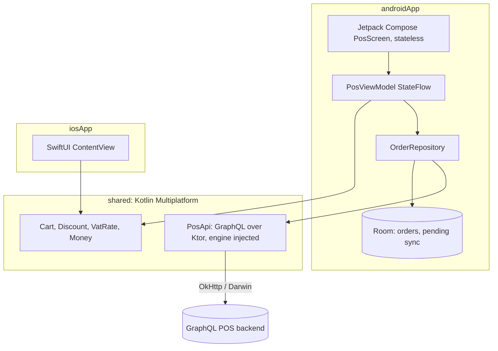

# kmp-compose-swiftui-pos

A point of sale demo built with **Kotlin Multiplatform**: one shared Kotlin module holds the cart, pricing, discounts, Irish VAT and a typed **GraphQL client**, used by an **Android Jetpack Compose** app (with **Room** for offline first orders) and a small **SwiftUI** iOS client. The Android side is covered by **Compose UI tests and Roborazzi screenshot tests** that run on the JVM through Robolectric, so CI needs no emulator.

> Portfolio demo. VAT rates are an illustrative Irish snapshot, the GraphQL backend is mocked in tests, and the iOS client is a minimal sample that is not built in CI.

## Problem

A POS has to compute the same totals on every device, keep working when the network drops, and sync orders exactly once when it comes back:

- **Shared logic:** pricing rules written once in Kotlin, compiled for Android (JVM) and iOS (native framework).
- **Money correctness:** integer cents, VAT per rate, basket discounts allocated across lines so VAT is charged on the discounted amount.
- **Offline first:** every sale is written to Room first with a client generated id, then synced; the id doubles as an idempotency key on the server.

## Architecture



## Project layout

| Module | Contents |
|---|---|
| `shared/` | `Cart` (immutable, merge lines, quantity, discounts, proportional allocation, VAT by rate), `Money` helpers, `PosApi` (products query, submitOrder mutation, GraphQL error handling). Targets: Android, JVM, iosX64, iosArm64, iosSimulatorArm64 |
| `androidApp/` | Compose POS screen (product grid, basket, discount chips, totals, pay), `PosViewModel`, Room `OrderEntity`/`OrderDao`/`PosDatabase`, `OrderRepository` with offline sync |
| `iosApp/` | SwiftUI client using the shared `Cart` through the `Shared` framework |

## Run it

```bash
./gradlew :androidApp:installDebug          # needs the Android SDK and a device or emulator
./gradlew :shared:jvmTest                   # shared logic tests
./gradlew :androidApp:testDebugUnitTest     # Robolectric UI, screenshot and Room tests
./gradlew :androidApp:recordRoborazziDebug  # write screenshots to androidApp/screenshots
```

The app expects a GraphQL endpoint at `BuildConfig.GRAPHQL_URL` (default `http://10.0.2.2:4000/graphql`). Without one it still works: it uses the bundled catalogue and queues orders for sync.

For iOS, see [iosApp/README.md](iosApp/README.md).

## Tests

- **Shared (`commonTest`, run on JVM and Android host):** line merging, VAT per rate (9%, 13.5%, 23%, 0%), percent and fixed discounts with caps, allocation that always sums exactly, validation, money formatting, and the GraphQL client against Ktor's `MockEngine` (query parsing, variables, GraphQL errors).
- **Compose UI tests (Robolectric):** pay disabled for an empty basket, totals after taps, discount chips, quantity decrease, pay callback.
- **Screenshot tests (Roborazzi):** empty basket and a full basket with a discount, captured as PNGs; CI uploads them as a build artifact.
- **Room + sync:** in memory database, totals stored on checkout, orders queued while the mocked server is down and synced once it is back.

CI (GitHub Actions, Ubuntu) runs the shared tests, the Android tests and screenshots, and builds the debug APK.

## Design decisions

- **Immutable cart in shared code** works naturally with Compose `StateFlow` and SwiftUI `@Published`.
- **Discount allocation by largest remainder** so line level VAT is correct and rounding never loses or invents a cent.
- **HTTP engine injected into `PosApi`**, keeping the shared module free of platform code and making tests trivial with `MockEngine`.
- **Stateless `PosScreen`** takes state and callbacks, so UI tests and screenshots need no ViewModel or database.
- **Room in the Android app, not shared:** stable Room is Android only; the repository interface would move to shared if using SQLDelight or Room KMP.
- **A hand written GraphQL client** rather than Apollo code generation keeps the build small; the queries are constants that could move to `.graphql` files with Apollo later.

## Limitations

- No real GraphQL server is included; the contract is exercised with mocks.
- The SwiftUI client is minimal and is not compiled in CI (needs a macOS runner).
- Screenshot baselines are recorded, not yet verified against committed images.
- No payments, printers, auth or multi currency.

## License

MIT
